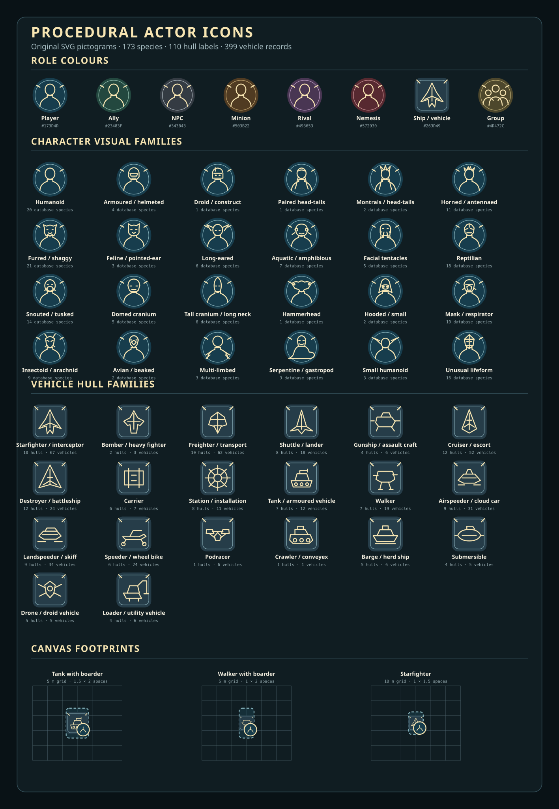
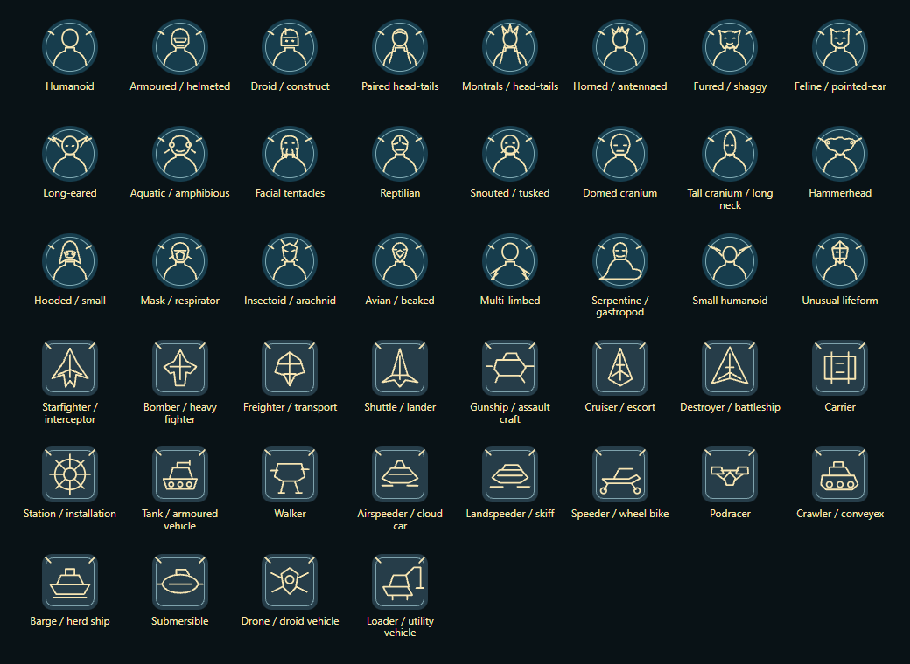

# Procedural actor icons

When an actor has no portrait of its own, Star Wars FFG draws an original icon that shows the actor's table role and its species or hull family at a glance. The same icon becomes the default token, so GMs and players can recognise actors, sheets and tokens consistently.

The icons are deterministic SVG drawings. Nothing is generated by an image model, and the files contain no external resources.

## What an icon shows

- **Background colour** shows the actor's table role: player, ally, NPC, minion, rival, nemesis, ship or vehicle, or Group.
- **Line symbol** shows an abstract species family for characters and a hull family for vehicles.

A GM can override the role with `flags.star-wars-ffg.iconRole`. Vehicle sheets offer the hull selector directly.

There are 24 character families and 20 vehicle families. Every one of the 173 distinct species names, 110 hull labels and 399 vehicle records in the published reference database has an explicit assignment. The families are deliberately abstract identifiers, not copied likenesses or claims about exact anatomy. New or community-provided names use a labelled fallback until their mapping is reviewed.

## Frames and facing marks

Character badges are circular. Vehicle portraits use a rounded-square frame, and vehicle token badges adapt to the occupied rectangle. Both keep the inner frame and the marks at 10 and 2 o'clock. The marks rotate with the token, giving a simple facing cue. A custom portrait keeps the same frame on the character sheet and on the canvas.

Vehicle tags reach the outer rounded edge and cross the inner ring at their midpoints. Generated badges already contain their frame, so the canvas does not add a second outline. Frames around custom portraits follow the displayed image within the token's occupied footprint.

## Image quality

The icons remain SVG files, which Foundry's canvas converts into cached textures:

- Vehicles are drawn at 2048 pixels on their longer side, with the other side in proportion to the token footprint. Backgrounds, inner borders and corner tags fill the rectangle, while the hull symbol stays centred and scales evenly.
- Characters are drawn at 512 × 512 pixels.

Resizing a token regenerates its badge in the same update, without changing its occupied dimensions or stored bearing. Custom images keep their chosen fit. Zooming in far beyond the texture resolution can still soften edges.

## Portraits and tokens stay in sync

The actor portrait is also the default prototype-token image, so the Actor, its sheet and newly placed tokens share one identity. When a world loads, placed tokens still using Foundry's mystery-person image or an earlier system-managed badge are updated to match.

Choosing a database species or vehicle model updates the matching default portrait and managed tokens. Choosing a vehicle model also resets the hull-symbol override to automatic, so the database hull and purpose decide its symbol and role colour.

Images you choose yourself are kept:

- A deliberately selected prototype-token or placed-token image is preserved.
- Changing a token image manually removes that token from later automatic portrait updates.
- A custom portrait or separately chosen token image stays intact when the species or model changes.

## Facing and rotation

Facing uses Foundry's native bearings: 0° south, 90° west, 180° north and 270° east. The icon artwork faces north, so it is displayed with a 180° offset; movement, sight and Director of Realms still read the unchanged Token rotation. New portrait prototypes default to north, so newly placed actors appear upright. Existing placed tokens keep their stored bearings, which can visibly turn older icons whose previous orientation was backwards. Rotation locks and separately chosen token artwork behave as normal.

To turn a token, use the **CW** and **CCW** buttons on the right-click token HUD: 45 degrees per click, or 15 degrees with Shift. Rotation respects token ownership and rotation locks. It changes the native bearing without spending a manoeuvre, because changing facing alone does not mean a rules manoeuvre happened. [Actions and manoeuvres](turn-indicators.md) tracks that spending separately.

Vehicle tokens keep their bearing when moved. The system turns off Foundry's movement auto-rotation for vehicles before the move is committed, covering both the animation and the stored bearing, without locking explicit rotation. Character and adversary tokens follow the core auto-rotation preference.

## Vehicle token size

Vehicle sheets store a footprint:

- **Automatic** sizes a square token from silhouette alone; the hull choice affects only the drawing. The metre values are a display calibration, not a rules-defined conversion from silhouette to physical size.
- **Exact** accepts published dimensions in metres. When the vehicle is placed, these are converted using the scene's grid distance and unit and rounded outwards to the nearest half grid space. Gridless scenes ignore stored grid-distance values and use a bounded visual size.

Vehicles sort below character tokens, so a character can stand on a tank, walker or other boardable vehicle. Manually resizing a placed vehicle turns off later automatic resizing for that token; the public `game.system.api.actorIcons.resetVehicleTokenFootprint(token)` helper restores it.

## Limitations

- Species and hull families are abstract symbols, not exact likenesses.
- Finer rotation steps would be a display control, not a turning allowance. The *Edge of the Empire Core Rulebook* describes abstract vehicle movement (printed p. 232). For attacks against silhouette 4 or smaller the defender normally chooses the defence zone, while silhouette 5 and above uses relative combat position (p. 235); specific actions such as Gain the Advantage apply their own exceptions. A displayed token angle must not silently replace those decisions.

The icon set is checked automatically for alignment, image resolution and complete database mapping; the latest result is in [actor-icon-audit.json](../development/actor-icon-audit.json).
