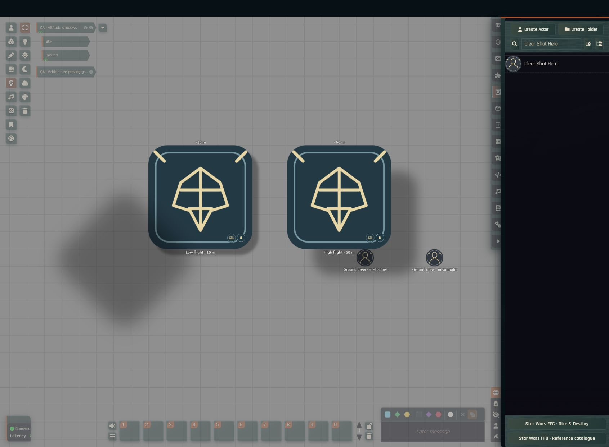
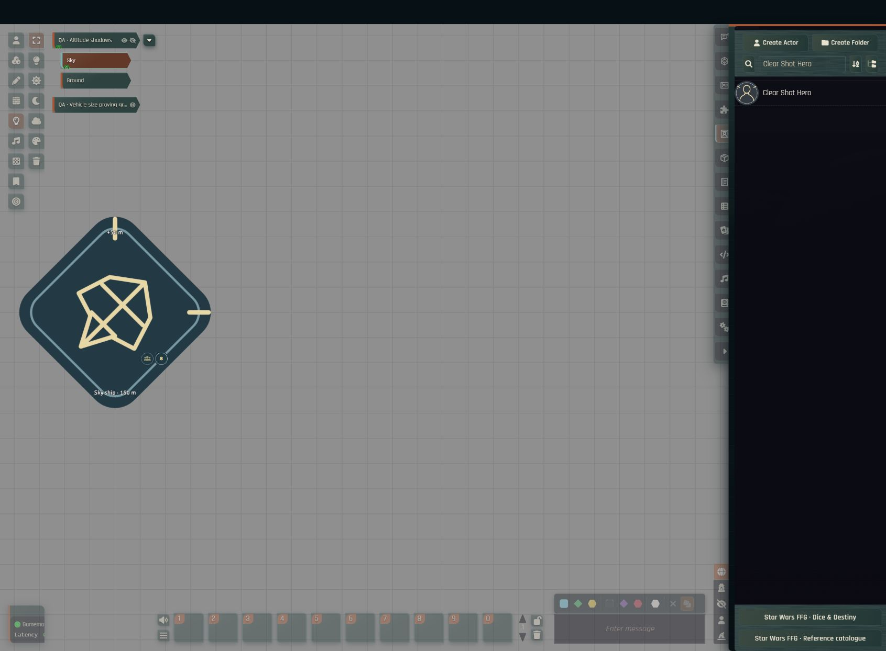

# Altitude shadows

Altitude shadows give a visual cue for height: elevated actors and vehicles cast their artwork silhouettes onto visible level surfaces and onto lower actors. The GM configures them per scene, and each player can turn them off on their own client.

A ship on a native Foundry Sky level can cast a shadow onto Ground even when its own token is not shown in that view. Hidden, invisible and embarked actors do not cast shadows.

## Configure a scene

The GM opens **Star Wars FFG · Range bands → Altitude shadows** in the left scene controls. Each scene stores its own direction, sun height, feathering, opacity and altitude scaling.

To turn shadows off for yourself, use **Configure Settings → Star Wars FFG → Show altitude shadows**. This only affects your client.

## Height and softness

Logarithmic scaling is the default. It uses the actual height above each receiving surface, compressed as `reference × log(1 + height / reference)`. The reference defaults to 50 scene distance units; a lower reference compresses more. Linear scaling is also available.

A larger height gap increases both the shadow's displacement in the chosen direction and its feathering. The same ship therefore casts a tighter shadow on a raised vehicle than on the ground. At orbital heights, logarithmic growth avoids the extreme offsets that linear projection would produce.

These settings change only how shadows look. They never change elevations, combat distances, firing arcs or dice pools.

## Receiving surfaces

- A level receives shadows at its native base height unless the GM sets a surface-height override.
- Turn off **Viewed level receives shadows** for open sky or empty space. This disables the level's flat plane; lower actors can still receive shadows.
- A visible actor receives shadows at its elevation plus its native token depth, converted from grid spaces into scene distance units. Adjust the token depth if its top height looks wrong.
- Actor shadows are clipped to the receiving artwork's transparency, including rounded badges and custom portraits. They follow movement, rotation, scaling and flipping. Names, status icons and interface controls are never shaded.
- A token cannot shade itself or an actor above its own elevation. The ground and each lower actor are calculated independently.

## Performance

Shadows update in response to document and canvas events, batched into one animation frame, with no idle timer. Moving a token reuses its prepared silhouette; changing its artwork, size or height rebuilds it. Each shadow image is limited to 512 × 512 pixels. Receiver masks are shared, unused overlap images are released, and cleanup removes only the system's own textures, leaving Foundry's source-art cache intact.

## Limitations

- Shadows are a stylised cue, not an astronomical lighting simulation.
- Receiving surfaces are flat planes and artwork masks. Roofs, terrain contours, building walls and intervening hulls are not traced as 3D shadow blockers.
- Shadows have no mechanical effect: they do not grant darkness, concealment or cover.
- The feature does not need the Director of Realms module.
