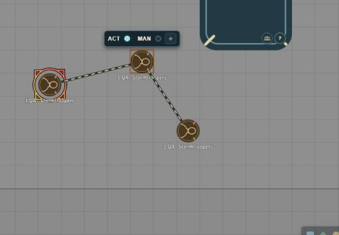

# Linked minion groups

Linked minion groups let the GM place several minion tokens on a scene and run them as one combat group, with shared wounds, skill ranks and turn spending. Players see the group's connections and casualties on the canvas.

## Link minions into a group

1. Place matching minions as **single-member**, unwounded tokens on one scene. Members must have matching statistics, ownership and equipment, and must not be aboard a vehicle.
2. Select them together.
3. Use **Star Wars FFG · Range bands → Link selected minions / manage group**.

The GM can link 2–100 members before adding them to combat.

Linking creates a fresh shared actor. Each token keeps its location, and the original actors remain as reusable templates. Wounds, trained group ranks, equipment and turn spending all belong to the shared actor.

Adding several members to the combat tracker through the system creates only one group slot. The linked actor cannot be dragged out as an extra, unregistered token; use the original template to make another group.

## See the group on the canvas

Selecting any visible member shows animated dashed lines between the surviving members. The lines form a minimal connecting tree, stop at the token bases, and disappear when no member of the group is selected. With reduced-motion preferences the dashes are static. Players do not see hidden or locally invisible members. The animation uses CSS and updates only when the geometry changes, with no idle canvas polling.

## Manage members and wounds

Open **Manage group members** from the shared sheet, the token HUD or the same scene control.

- Wounds use the standard pooled minion threshold calculation.
- As members become casualties, they drop out of the connections in roster order; healing restores them in reverse order. A crossed circle marks a member who is out of action.
- **Temporarily unavailable** sets aside a specific disabled or separated member without removing them from the group.
- The number of remaining members sets the group's trained skill ranks, up to 5. Untrained skills stay at rank 0.
- A group with no active members cannot roll a check.

**Apply damage** on the sheet accounts for soak. The wound field in the roster is a direct total.

### Removing tokens

Deleting a token removes its membership. Wounds that belonged to an already-defeated member are taken off the shared total, so another survivor is not defeated twice. A deleted token cannot rejoin through healing. To keep the change reversible, leave casualties on the scene instead.

## Move a group in combat

The first member's completed drag spends one shared manoeuvre. Every other active member can then make one drag under that same manoeuvre. A further drag by a member who has already moved needs another ready manoeuvre. This is stored in the shared turn record and survives reloads.

Minions cannot buy manoeuvres with strain, but the group can trade its action using the usual turn controls (see [Actions and manoeuvres](turn-indicators.md)).

## Limitations

- Movement spending does not decide how many narrative manoeuvres a long map move should cost.
- Linked groups cannot yet split among vehicle stations or board as individual members. For vehicle occupants, use the aggregated minion crew workflow in [Vehicle crew](vehicle-crew.md).
- Splitting or merging established linked groups, and choosing a different casualty order, are not yet available.
