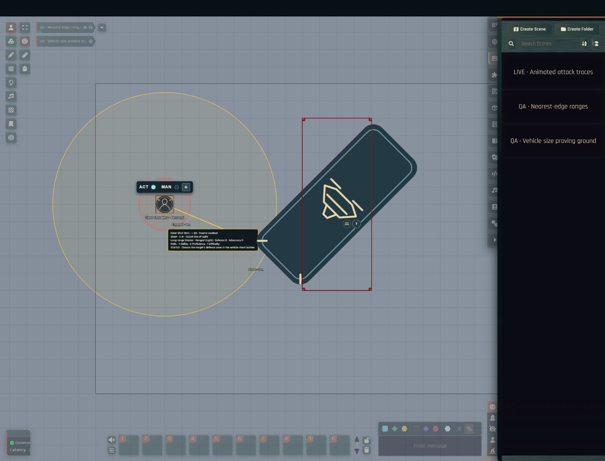
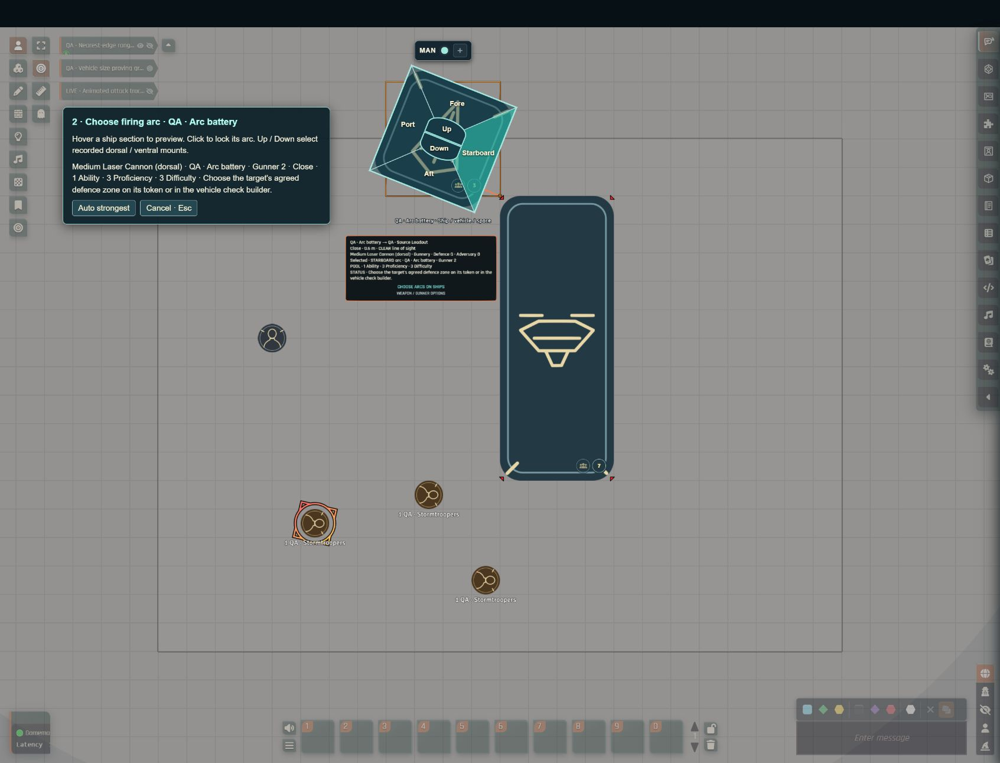

# Range bands

Range bands show narrative range around a token on the scene, and the combat range assistant uses the same measurements to prepare attack pools. Both GMs and players use them in tactical encounters, on a map or in Theatre of the Mind.

The overlay is a table aid for narrative distance. It does not replace weapon qualities, movement rules or the GM's decision.

## Show range bands

The system adds a **Star Wars FFG · Range bands** group to Foundry's left scene controls.

1. Open the range-band control group and use **Select range origin** to select a token.
2. Turn on **Show colour range bands**. Every boundary has a text label as well as a colour.
3. Leave **Keep multiple selected origins** off if the overlay should follow the latest selected token. Turn it on to keep each newly selected origin until you use **Clear range origins**.

## Choose the range scale

The GM sets **Range context** to describe the scene. The selected attacker then decides which scale is shown and measured:

- A character, minion, rival or nemesis uses **Personal** ranges: Engaged, Short, Medium, Long and Extreme. A Theatre-of-the-Mind click anchors Short.
- A ship or vehicle in an ordinary or space scene uses **Ship / vehicle / space** ranges: Close, Short, Medium, Long and Extreme. A Theatre-of-the-Mind click anchors Close.
- A ship or vehicle in a **Battlefield / planetary** scene uses the longer surface-battle ranges. A personal attacker on the same scene keeps Personal ranges.

The same resolved scale drives the overlay, attack traces, automatic dice pools and the public and Director of Realms measurement APIs.

## Set the map scale

**Gridded scenes.** The scene's grid size, distance and unit set the scale. Common metric and imperial units are converted to the approximate boundaries in the supplied range reference; other unit labels use relative grid-space boundaries. While a map scale is available, any stored Theatre-of-the-Mind calibration is ignored.

**Gridless (Theatre of the Mind) scenes.**

1. Select an origin.
2. Choose **Calibrate Short range** or **Calibrate Close range**.
3. Move the pointer to that boundary and click.

The calibration is stored on the scene, separately for each of the three scales. **Clear current ToM calibration** removes only the active scale's value. The pointer sets the distance from the origin's edge to the Short or Close boundary. Anchors saved by earlier versions are kept but now extend from the token's edge, so recalibrate if a previous visual boundary must stay in exactly the same place.

## How range is measured

Bands start at the origin token's **edge**, not its centre. Character bands expand around a round base; vehicle bands expand around the rectangular occupied footprint, with curved corners. A target enters a band when its nearest edge reaches that boundary. Vehicle footprints and their expanded outlines follow token rotation unless rotation is locked. Portrait padding and image scaling do not change the measured footprint.

Measurements use the shortest **edge-to-edge** gap between token footprints, so touching or overlapping bases have zero horizontal separation. On scaled maps, the horizontal distance is combined with the tokens' elevation difference before a band is chosen; no token height is assumed.

When the shortest line is blocked but an alternative shot is clear, combat measurements use the clear shot's length instead (see [Animated attack trace](#animated-attack-trace)). The range overlay always shows distance from the footprint; the targeting line shows the usable firing path.



## Labels and captions

The origin caption sits beneath the token's displayed name and minion count, with a gap that stays visible when you zoom out. Its position follows the rendered nameplate, including wrapped text and Foundry's UI scale. If the name or count changes later, the caption and the space reserved around it for range labels and combat cards reflow.

Range labels sit along one guide line from each origin towards the furthest corner of the unobscured browser viewport, so the most distant visible bracket uses the longest available sightline. Each label follows its band's outline when the camera, sidebar or origin changes. Tokens, tiles, drawings, map notes, actor names, turn indicators, combat cards and open windows push overlapping labels along the outline. If a band contains the whole viewport and its outline is off screen, its label glides to a free position at the edge. A band wholly outside the viewport stays hidden.

## Combat range assistant

The **Combat range assistant** option in System Settings controls what happens when an encounter begins:

- **Automatic** shows the overlay and follows the active combatant. Each origin combines its actor type with the scene context: personal actors use Personal, ordinary vehicles use Ship / vehicle, and vehicles in a Battlefield scene use Battlefield. A new all-person encounter starts with Personal context and a new all-vehicle encounter with Ship / vehicle context. For a mixed encounter, the GM is asked to choose.
- **Ask when combat starts** lets each user decide whether to show the encounter overlay.
- **Off** leaves the range tool entirely manual.

**Follow the active combatant with range bands** moves the primary origin at each turn change; multiple-origin mode still keeps pinned origins. In an uncalibrated Theatre-of-the-Mind encounter, the GM is asked to place the range anchor. When the encounter ends, an overlay that opened automatically returns to its previous visibility and origin. Manual changes made during combat are kept.

Targeting a combatant adds its measured range to that combatant's row in the combat tracker, and a blocked Foundry sight line is shown on the same badge. The badge refreshes when targets change or a token move completes.

## Animated attack trace

**Animate attacker-to-target line** is on by default and can be toggled from the range controls. Select or activate an attacker, then target an opponent. The line is drawn over two seconds and its status card appears when the animation finishes.

### Read the line

- A clear line is solid and uses the colour of the target's measured range band.
- The line stays solid up to the first sight wall or visible intervening token, then continues as a red dotted line to the target. Hidden tokens are not revealed to players.
- If the nearest part of a large target is obscured or outside the selected weapon's firing arc, the assistant checks other parts of its outline against sight walls, visible tokens and the weapon's arcs. It refines clear paths on either side and draws the shortest usable shot it finds. That shot's length sets the range and weapon reach.
- A personal ranged attack can gain another difficulty die when a farther exposed section crosses into a longer band. Vehicle Gunnery keeps silhouette-based difficulty.
- When the nearest point is obscured, the card reports **CLEAR path · nearest point obscured** and **COVER · GM review**. Cover dice are never guessed.

### Read the card

The card names the attacker, target, weapon and skill, and reports range, map distance, line of sight, Defence, Adversary and the complete automatic pool.

The card moves clear of visible tokens, props, map annotations, actor names, turn indicators, other combat cards and open windows, and range labels then move around it. It is repositioned only when the camera, a window, the sidebar or a placeable changes. Reduced-motion preferences turn off the glide. If no clear space is large enough, the card stays inside the viewport at the least obstructed position.

### Send dice to the pool

1. On a valid card, click **SEND DICE TO POOL**. This replaces the compact chat-side pool with those exact dice and keeps the attacker, weapon, automatic results and applied-rule notes.
2. Add or remove Boost, Setback or other dice in the tray.
3. Use the tray's roll button.

Loading a second attack replaces the staged pool rather than combining two attacks. A blocked, out-of-range or otherwise invalid card explains its status and will not send dice; the character sheet's Manual pool remains the GM's override.

Vehicles automatically compare legal mounted weapons with eligible assigned gunners, using the crew actors' actual characteristics, skills and automatic modifiers. An uncrewed vehicle cannot invent a gunner.

## Vehicle arcs and attack selection

### Automatic weapon choice

By default, **Auto strongest** chooses the legal weapon and gunner combination with the greatest expected raw impact, using hit chance and then the shorter shot as tie-breakers. It calculates the exact success/failure distribution of each pool and converts vehicle damage to personal-scale units for comparison. This is a transparent rule of thumb applied before armour, weapon qualities, ammunition expenditure and optional symbol spending. It does not guarantee the tactically best choice.

### Choose arcs on the canvas

Use **Choose arcs on ships** on the combat card:

1. Target an opponent as usual.
2. Hover over the attacking ship's Fore, Aft, Port or Starboard section to preview that arc's strongest available attack. The two smaller central **Up / Down** sections select recorded dorsal and ventral mounts. Click a valid section to lock the firing choice. Red sections explain why they cannot fire.
3. For a vehicle target, hover over its hull faces. The shot moves to an exposed point on that face and previews its shields, distance and pool. Click to confirm the agreed defence zone. A far-side or obscured zone cannot be selected through the hull. Standard vehicle data has four shield zones, so the central Up / Down controls are disabled on this step rather than inventing extra shield values.
4. Use **Send dice to pool** to stage the editable dice. Nothing is rolled.

Hovering only previews: it does not change the saved choice, roll dice or spend a resource. **Back to attacker**, **Auto strongest** and **Cancel / Escape** are available throughout. With the keyboard, focusing a section previews it and Enter selects it. Panning and zooming keep the controls attached to the hull. Changing tokens or targets cancels an unfinished selection. If the GM makes a narrative shield-zone ruling instead, use the sheet's Manual mode.



### Choose a weapon and gunner yourself

The optional **Weapon / gunner options** control keeps explicit mount and crew selection. A manual choice stays selected on that client until Auto is restored or the page reloads. If the choice becomes blocked or the weapon is removed, the system reports the problem instead of silently replacing it. Shield choices are tied to the chosen target.

### How firing zones are drawn

Both the attacker and defender overlays anchor their boundaries to the hull corners:

- Fore and Aft cover the front and rear faces; Port and Starboard cover the side plating.
- The internal joins bisect each corner at 45 degrees, and firing-zone boundaries extend outwards from the same corners. Long hulls therefore have small end wedges and longer side regions.
- Labels, hover regions, shot validation and the range used for the automatic pool all use this shared geometry.
- The defence endpoint must reach the selected face itself; it cannot stop partway down the side and count as Fore. Shared corners and firing boundaries allow either adjacent zone.
- A defensive corner also needs the right approach direction: the shot must arrive from outside the selected face. For example, a shot from above-left can reach the Aft/Port corner of a south-facing target, but cannot count as hitting the hidden right-hand Port face. Exactly tangent rays do not expose a face. This test follows the target's rotation, and the picker will not commit or stage an inaccessible zone.

Native Foundry rotation is kept, with south at zero. Imported `metadata.fireArcs` and `metadata.location` still restrict which zones a weapon supports, and **Firing arcs override** on the weapon sheet allows a deliberate correction. Unknown arcs fail closed. Dorsal and ventral restrictions use relative token elevation; a vertical mount is never inferred from a side-mounted weapon.

### Levels and altitude

Level-aware checks combine elevation with walls, floor and ceiling surfaces and configured actor depth. **Star Wars → Flight · level and altitude** moves an owned token and its embarked crew between native levels, and attack cards show above/below separation. See [Layered flight](layered-flight.md) for setup and limits.

## Rolls from the character sheet

When an acting character has a token on the scene and the user targets another token, the skill pool builder on the sheet reads the measured band automatically. **Modify this pool** and Manual mode remain available for narrative adjustments.

## For integrators

External tools can read the same result:

```js
const source = canvas.tokens.controlled[0];
const target = [...game.user.targets][0];

game.system.api.range.measureTokenRange(source, target);
game.system.api.directorOfRealms.getCombatRange(source, target);

// Pass a mounted weapon to constrain the measurement to its recorded arcs.
game.system.api.range.measureTokenRange(source, target, { weapon, fireArc: "fore", defenseZone: "aft" });
game.system.api.range.vehicleAttackOptions(source, target);
game.system.api.range.chooseAttackArcs(source, target);
```

The result reports availability, canonical scale, band, map or Theatre-of-the-Mind mode, pixel distance, map distance and units, vertical separation, native levels and height-aware line of sight when those scene references are available. The sheet and Director of Realms share this result:

- `measurement: "edge-to-edge"`. `sourceEdge` and `targetEdge` are the geometric closest points, including rectangle corners and rotated hulls.
- `traceSource` and `traceTarget` describe the selected firing segment.
- A diverted shot reports `distanceBasis: "clear-shot"`, `sightPath: "alternate"` and `partiallyObscured: true`. An ordinary shot reports `nearest-edges` and `nearest`.
- The main distance and band fields always drive the attack pool. `nearestDistancePx` and `nearestSceneDistance` keep the geometric gap separately.
- Overlapping footprints fall back to token centres for their initial sight ray. If no checked path is clear, the original blocked ray and first obstruction remain visible.

Automatic ranged rolls stop in these cases, and Manual mode remains available for a GM-approved exception:

- An uncalibrated gridless scene fails closed rather than guessing a band.
- A target outside the displayed Extreme boundary reports `beyond`, which prevents an automatic attack pool until the table changes the range or makes a manual ruling.
- A sight-blocking wall or surface, or `requiresGmRuling`, stops an automatic ranged roll.

### How the visibility search works

The search uses 32 outline samples plus exact intersections with outward firing rays from hull corners and face centre lines, the selected defensive face's corners and its nearest point, followed by 14 refinement steps on each side. It runs only after the nearest ray is blocked or falls outside the allowed arcs or zones. The extra boundary points preserve shots shared at exact hull corners and firing boundaries.

Ordinary clear shots need one wall query per traversed native level; alternative cases use a bounded search with a final confirmation. Weapon and gunner comparisons reuse geometry within the same evaluation. Each possible shot must clear walls, native surfaces, visible token volumes and the allowed arc or zone on the same segment, and a missing check never counts as clear.

Overlays, labels, badges and cards update in response to events. There is no idle polling or idle animation loop.

## Limitations

- The overlay and its numeric boundaries are a canvas measurement convention and a table aid, not a precise miniatures rule from the books. The *Edge of the Empire Core Rulebook*, printed pages 208–209, describes abstract relative range and leaves final range adjudication to the GM.
- The corner-based firing-zone layout is this system's canvas convention, not the centre-based 90-degree diagram in the core book's Fire Arcs section.
- **Auto strongest** is a heuristic. Ion effects, limited ammunition and other situational priorities remain table decisions.
- The visibility search is bounded, not a full visibility polygon. A very narrow gap between samples may still need the Manual pool.
- Cover, access to a hatch and whether an apparent engagement is possible need GM judgement. Cover dice are never added automatically.
- Cross-level gaps, overlapping level volumes, unavailable collision support and vertical Theatre-of-the-Mind checks disable Auto and ask for a GM ruling.
- Theatre-of-the-Mind calibration is two-dimensional.
