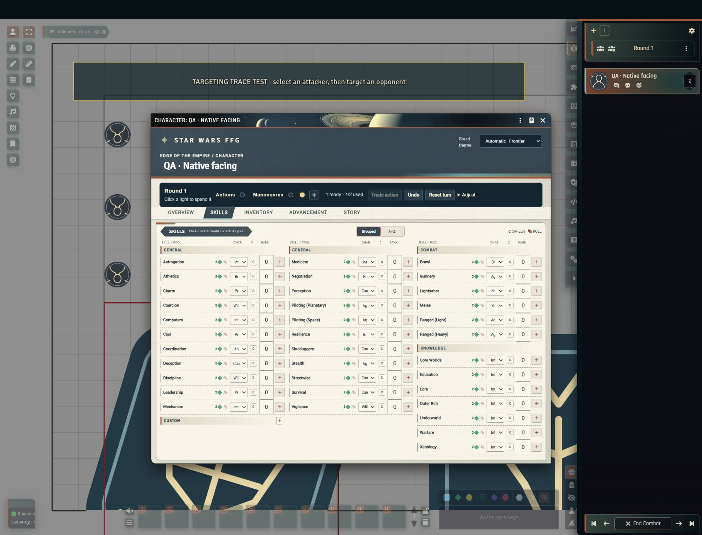

# Actions and manoeuvres

Turn indicators track each actor's actions and manoeuvres during a turn, on the character sheet and above selected tokens. Players use them to see and spend what they have left; the GM decides how much players may manage themselves.



## Read the turn strip

The character sheet keeps the turn strip visible on every tab. On the canvas, only selected, controlled tokens show the same lights above their artwork.

- A filled light is available.
- A hollow light is spent.
- A temporary amber light with a dashed edge is a manoeuvre that was bought or awarded.

### Where the canvas strip appears

The canvas strip moves clear of the token's right-click controls, including the elevation field, rotation buttons and expanded palettes. It also avoids visible windows and canvas controls, and picks a nearby position inside the viewport when there is no room above the token. Closing the token controls restores the usual position.

Rendered elevation, level and name labels, including those on nearby tokens, also reserve space; their positions account for camera zoom and display scale. Editing a height or refreshing a token's visibility repositions or restores the strip without reselecting the token. Layout follows panning, zooming, window movement and palette changes in batched frame updates, with no idle polling.

## Choose who manages indicators

The GM chooses the policy under **Configure Settings → Star Wars FFG → Turn indicators: player control**:

- **GM / automatic only** (default): the GM manages manual spending, additions, undo and resets. Player checks and committed moves still update automatically.
- **Players manage their own indicators**: owners may also spend, buy, trade, grant, undo and reset their own indicators, with the same manoeuvre cap. Setting base allowances and confirming conditional talent activations remain GM tasks.

The policy is checked both when controls are displayed and when the authoritative GM or the owner commits the request. Requests are queued one at a time per actor (by actor UUID, so separate unlinked actors are handled separately). Resource payment and the spending record are saved together, so a second request cannot spend the same remaining action. This is a cooperative Foundry workflow: owners keep Foundry's normal document-editing permissions.

## Spend, buy and reset

Characters start each turn with one action, one free manoeuvre and a maximum of two manoeuvres.

- After the free manoeuvre is used, **+** pays two strain (by default) and prepares another manoeuvre light. Spending that light uses the manoeuvre.
- **Trade action** exchanges the action for that extra manoeuvre light instead.
- **Adjust → Grant manoeuvre** adds a manoeuvre awarded by the rules, within the cap.
- **Undo** reverses the last entry and its recorded resource payment.
- **Reset turn** restores allowances without healing strain or wounds.

## Automatic spending in combat

### Checks

During combat, a completed skill check spends the selected **Turn cost**: Action, Manoeuvre, or Incidental / already spent. The full pool builder and a combat attack sent to the quick tray both show this choice.

- Cancelling the builder, or a failed dice evaluation, spends nothing.
- Initiative rolls are excluded.
- Unclassified raw dice and Force-resource rolls do not spend an action.
- `actor.rollSkill` and the Director of Realms adapter use the same check path. Integrations can pass `turnCost: "none"` for a check that has already been paid for.

### Token movement

With **automatic token drags** turned on, one completed drag in combat spends one ready manoeuvre after the move finishes. A movement preview spends nothing. An actor with no manoeuvres left must buy, trade or be granted one before dragging again.

Keyboard nudges, token configuration, API moves, undo and forced moves do not spend anything. Integrations can mark an update `starWarsFreeMovement: true` or spend explicitly through the API.

A drag counts as one movement declaration; it is not converted from metres into narrative manoeuvres. The GM handles a move that needs more than one manoeuvre and any movement granted outside the actor's turn. Tables that prefer manual declarations can turn the automatic-drag setting off.

### Rounds

Advancing a combat round restores the lights without changing accumulated strain. Going back to a recent round restores what was spent in it; the record keeps the latest twenty visited rounds. Outside combat the strip is manual and has an explicit reset.

Star Wars initiative slots still need the table to decide who acts in each slot. Moving the combat tracker to the next slot does not spend another actor's allowance.

## Minions, rivals and vehicles

- Minions cannot voluntarily pay strain. Rivals pay wounds instead.
- Vehicles show a separate pilot-only manoeuvre budget: one free manoeuvre, and at most two for silhouettes 1–4 or one for silhouette 5 and above. The extra vehicle manoeuvre costs system strain. The pilot must also spend their own manoeuvre and any personal strain; no other crew member is charged automatically. Vehicle actions belong to crew members.

### Vehicle facing

Vehicle movement keeps the hull's current facing, even when Foundry's **Automatic Token Rotation** preference is on. Reversing or moving sideways does not rotate the hull or its firing arcs. To turn, use the right-click **CW** / **CCW** buttons (45°, or 15° with Shift); integrations can supply an explicit rotation update. Personal tokens follow Foundry's preference. This separates facing from movement; vehicle-specific manoeuvre restrictions remain a rules or GM decision.

## Adjust allowances and talents

The GM edits base allowances under **Adjust → Allowances** on a character sheet. Prepared Active Effects on `system.turnEconomy` are included.

Learned specialization or signature nodes and owned talent Items can declare structured turn effects, for example:

```json
{
  "activation": "Passive",
  "effects": [
    { "type": "turn", "target": "freeManeuvers", "operation": "add", "count": 1 }
  ]
}
```

- Targets are `actions`, `freeManeuvers`, `maneuverLimit` and `strainCost`. Values are limited to 0–10.
- A turn effect can require a skill and minimum rank, for example `requirements: {"skill":"pilotingSpace","minimumRank":3}`.
- Ranked learned nodes stack; duplicate unranked rules do not.
- Skill rank alone does not grant extra actions.
- Active turn effects are shown to the GM for confirmation after their prerequisites and separate costs are checked.

## For integrators

```js
game.system.api.turns.read(actor);
await game.system.api.turns.perform(actor, "maneuver");
await game.system.api.turns.perform(actor, "buyManeuver");
await game.system.api.turns.perform(actor, "reset");
await game.system.api.turns.rotateToken(token.document, "cw", 45);
```

The Director of Realms actor context includes the same remaining allowances, spending, resources, applicable rules and unresolved talent decisions.

## Limitations

- A talent without an encoded effect does not change the budget. A talent that changes the cost of a particular task is not treated as an extra general action.
- The Director of Realms context records the mechanics the system knows about. It does not mean every expansion talent has been encoded or tested live with Director of Realms.
- Movement spending does not decide how many narrative manoeuvres a long map move costs, and vehicle-specific manoeuvre restrictions are not automated.
- The tracker does not decide who acts in an initiative slot.

## Rules references

Rules were checked against the *Edge of the Empire Core Rulebook*: pp. 199–203 (incidental, manoeuvre and action economy), p. 232 (vehicle pilot-only manoeuvres) and pp. 389–391 (adversary handling). This guide describes the system's implementation; use the books for the complete rules and their exceptions.
