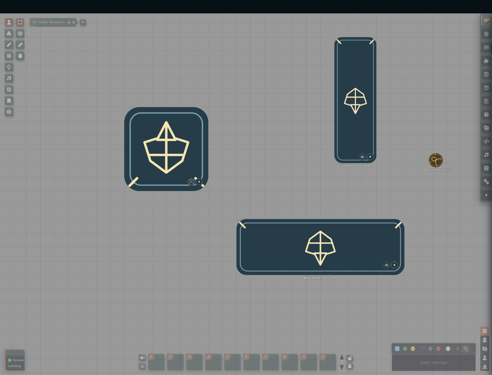
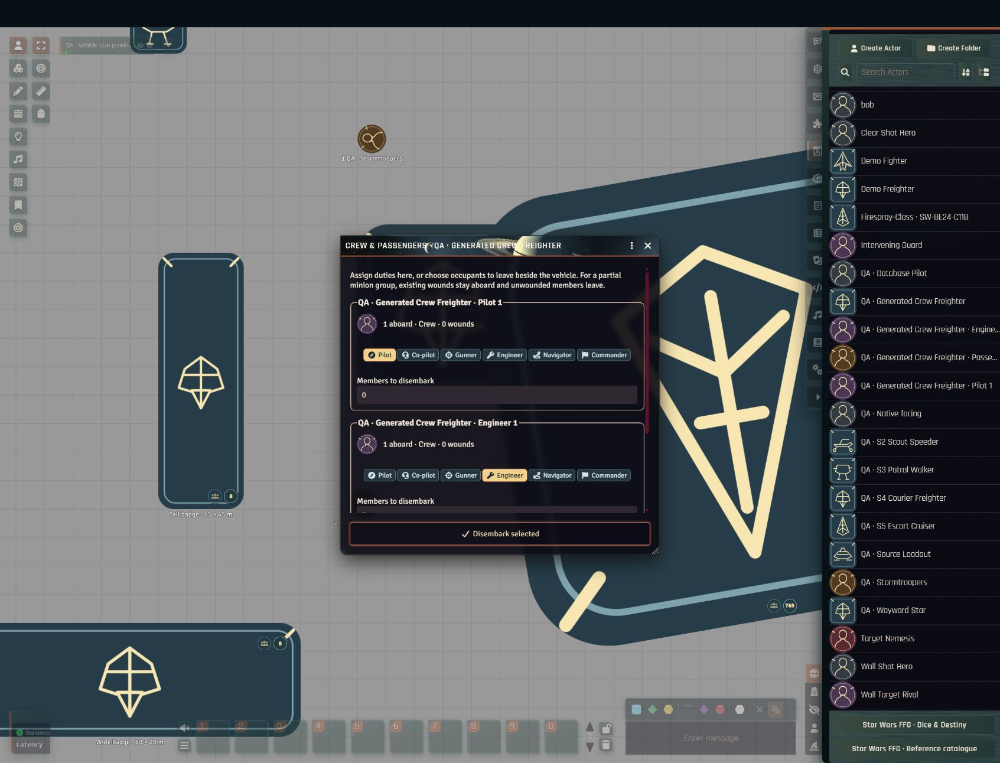

# Vehicle crew and passengers

The **Crew & Passengers** tab and the crew controls on vehicle tokens let you put characters and NPCs aboard a vehicle, assign their duties and roll checks with the assigned crew's own skills. GMs use it to prepare or generate crews; players use it to board, take stations and fly.

The tab follows **Overview** on the vehicle sheet. The GM can prepare a crew before placing a vehicle, or generate extra occupants for an existing token. Boarding belongs to a placed vehicle on the current scene, so select the intended token when several copies of an actor exist.

## Generate a crew

1. On the vehicle sheet, choose **Generate crew**.
2. Select a species from the campaign-filtered catalogue (the field supports fuzzy search) and set the specialist skill rank.
3. Enter the number of crew for each duty. By default, vacant crew places are filled with one pilot and unassigned support crew; passenger places stay empty unless you request them.
4. Choose **Preview crew** to see every proposed NPC sheet.
5. Choose **Create crew** to create them. Nothing is written before this step. **Back** keeps your choices; closing either window cancels.

### What is generated

- Pilot, Co-pilot, Gunner, Engineer, Navigator and Commander presets are individual rivals trained in the matching duty skills.
- Support crew and passengers are untrained minion groups of at most 100.
- Species characteristics and thresholds come from the recorded species profile.
- Portraits are drawn procedurally from the species and NPC category. No AI service is involved.

These are original, editable NPC presets, not complete official adversary profiles. The sheets keep a species-ability review marker and do not invent equipment, talents or XP.

At most 1,000 occupants or 50 NPC Actors are generated per batch; large support complements use minion groups. If creation fails, only the documents created by that batch are rolled back, and any cleanup failure is reported explicitly.

### Prepared crews for unplaced vehicles

For a vehicle that is not yet on a scene, the new NPC Actors appear in the Actors directory and in the vehicle's prepared roster. Open their sheets to edit them. **Remove** removes only the prepared reference and keeps the Actor.

When a GM is connected, placing the vehicle automatically puts unlinked copies of its prepared crew aboard that token. Each copy of the vehicle gets its own crew tokens. If a missing actor or capacity problem stopped this, fix it and use **Board prepared crew** on the sheet to try again. Members already deployed are not recreated after they disembark.

### Adding crew to a placed vehicle

For an existing vehicle token, generation boards only the new members and keeps current occupants. Capacity and the single-pilot rule are checked again during boarding, before anything is created.

## Use the token controls

Two small circles sit together in the vehicle's lower-right corner:

- **Vacancy circle**: the combined number of free crew and passenger places. Hover for the separate counts. It shows `+` for one free place, `0` when full, and `?` when the GM needs to set an exact capacity. Large numbers are shown compactly. This circle also offers a character chooser for boarding.
- **Pilot / roster circle**: shows the assigned pilot's portrait and represents everyone aboard; without a pilot it shows a crew symbol. Click it to open the full roster, assign duties, open an owned character's sheet or choose who disembarks.

The roster window can be resized, and its list scrolls independently of the action button at the bottom. Individual portraits and role buttons never cover the canvas.

Both circles, their text and their spacing shrink with the token as you zoom out. They are placed inside the actual rotated hull, so they never drift outside the vehicle at the screen edge. If the lower edge is off screen they move to the upper corner, and they hide when too little of the hull is visible. The sheet tab is available at every zoom level.

### Open an occupant's sheet

Double-click an occupant row in **Crew & Passengers**, or a portrait in the crew pop-up, to open that character's sheet. With the keyboard, focus the row or portrait and press Enter or Space. Prepared entries open the world Actor; occupants aboard open their own token Actor, including individual minion groups. Foundry's sheet-view permissions still apply. The compact pop-up uses the portraits for this instead of separate sheet buttons.

## Board and disembark

**Board:** drag a character or NPC onto a vehicle and confirm whether it enters as crew or as a passenger. While aboard, the original token is hidden from the canvas but keeps its own actor, items, dimensions and turn state. Its position and vision origin follow the vehicle.

**Disembark:** drag the pilot / roster circle back onto the canvas and choose which occupants appear at that position. The chooser starts with nobody selected, so the pilot's portrait never unloads the whole crew by accident. The pop-up also lets occupants leave beside the vehicle without dragging.

## Groups and duties

### Minion groups aboard

Minion groups take one place per surviving member, and their roster entry shows the member count. Separate groups stay separate documents even when they share a name and portrait; numbered labels, counts and owned-character wound totals help tell them apart.

When only part of a group leaves, the departing members become a separate unlinked group. Existing wounds stay with the members aboard and the departing members are unwounded. This keeps the total group size and avoids changing other copies of the base actor.

### Assign duties

Crew can hold Pilot, Co-pilot, Gunner, Engineer, Navigator and Commander duties.

- Only one primary pilot is assigned at a time. Clear the current pilot before assigning another.
- Passengers must leave and reboard into a crew place before taking a station.
- Assignment changes take effect immediately in the pop-up.

### Roll crew checks

Checks from the vehicle sheet use the assigned character's actual characteristics, skill ranks and learned talent modifiers. If several characters are eligible, you choose one.

- Piloting adds the vehicle's positive or negative handling before applicable talent adjustments.
- Gunnery uses silhouette comparison for base difficulty and still checks weapon reach. For a vehicle target, the defence zone must be agreed and selected.
- When an assignment is missing, no crew member or statistic is invented.

Completed crew checks use the character's own combat allowance, even when only the vehicle is listed in combat. The vehicle's pilot-manoeuvre allowance is tracked separately (see [Actions and manoeuvres](turn-indicators.md)).

## Ownership and capacity

- The GM can board or assign any character.
- Players need ownership of both the character and the vehicle to board or change duties, and ownership of the character to disembark.
- Other visible occupants appear read-only; hidden occupants are left out of player rosters.
- Seat changes are processed one at a time by the active transaction authority, including competing requests for the last place.

Numeric crew and passenger capacities come from the actor's database profile. The GM can use **Configure seating** on the sheet tab to set explicit usable capacities where the published complement is descriptive text or differs from the seats you want. Capacity never creates background crew actors automatically.

## What persists

Membership is stored on the scene's Token documents and survives reloads. A prepared roster is a reusable creation template, not a transfer of existing crew. Removing a vehicle releases its occupants.

## For integrators

`game.system.api.crew` provides `roster(vehicleToken)`, `context(vehicleActor)`, `capacities(vehicleToken)`, `vehicleForActor(actor)`, `assignedCheck(vehicleToken, skill, optionalMemberId)`, `board(characterToken, vehicleToken, seat)`, `leave(characterToken, optionalPoint)`, `toggleRole(characterToken, role)` and `openCheck(vehicleToken, skill, optionalWeapon)`.

- These functions use real Foundry documents in the authenticated client. Boarding and duty changes follow the same ownership and transaction checks as the interface.
- A point is a scene-space `{x, y}` centre for the departing token.
- `context` supplies serialisable capacities and visible token and actor references; the Director of Realms adapter includes these as `crewAssignments`.
- GM clients can also call `generate(vehicleActorOrToken, {speciesId, rank, counts})` and `deployPrepared(vehicleToken)`. Counts use `pilot`, `copilot`, `gunner`, `engineer`, `navigator`, `commander`, `support` and `passenger`. Generation validates the current campaign catalogue and seats in the same way as the interface.

`vehicleActor.rollSkill(skill, options)` delegates to the assigned character and accepts `vehicleToken` and `crewTokenId` to resolve ambiguity. Programmatic callers must supply an adjudicated difficulty and situational modifiers; use `openCheck` for the interactive range, silhouette and defence-zone workflow.

## Limitations

- Assigning roles does not automate all starship combat rules. Personal manoeuvre spending for piloting, individual weapon firing limits, arcs, speed restrictions, narrative positioning and unencoded special actions still need player and GM judgement.
- Live occupants and their ongoing state do not transfer automatically to another scene or to a copied token.
- Generated NPCs are editable presets, not official adversary profiles.
- Director of Realms use of the crew context has not yet been tested in a live campaign.
- Keep the source books available for rules the system does not encode.
